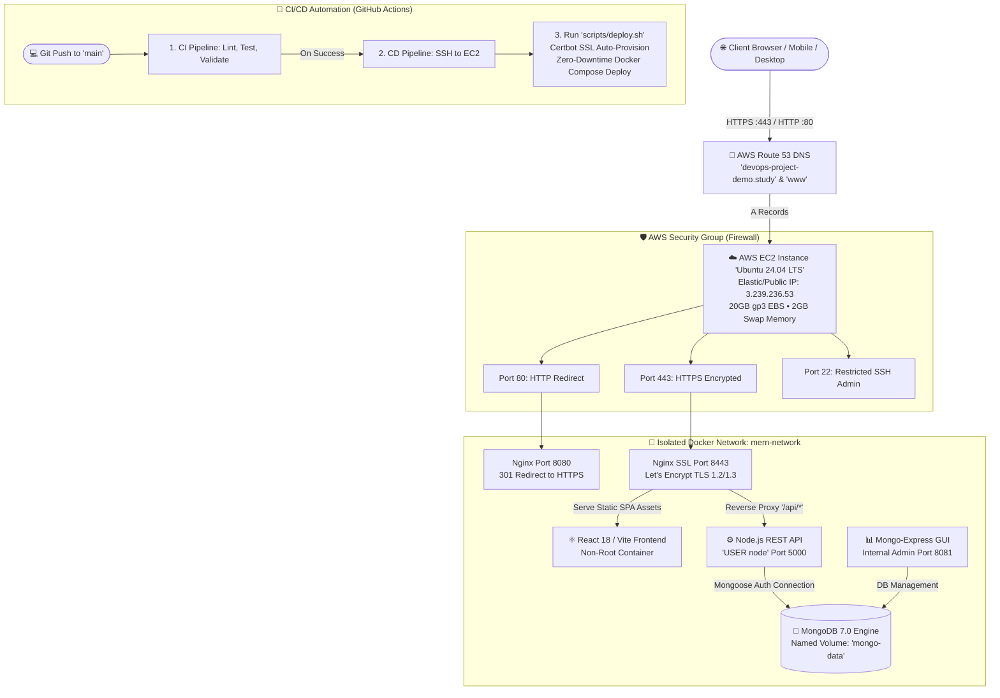

# ⚡ PromptVerse — AI Prompt Engineering Platform & DevOps Cloud Infrastructure

[](https://aws.amazon.com/ec2/)
[](https://www.terraform.io/)
[](https://aws.amazon.com/route53/)
[](https://www.docker.com/)
[](https://nginx.org/)
[](https://github.com/features/actions)
[](https://react.dev/)
[](https://nodejs.org/)
[](https://www.mongodb.com/)

A production-ready, full-stack **AI Prompt Engineering & Community Hub** deployed on **Amazon Web Services (AWS)** using modern **DevOps & Cloud-Native** practices. 

This repository demonstrates an end-to-end cloud deployment journey: from **Infrastructure as Code (Terraform)**, container orchestration (**Docker Compose**), and reverse proxying with **Nginx & Let's Encrypt SSL**, to automated **CI/CD Pipelines (GitHub Actions)** and automated DNS management (**AWS Route 53**).

---

## 🌐 Live Application URLs

* 🔒 **Production HTTPS (Apex)**: [https://devops-project-demo.study](https://devops-project-demo.study)
* 🔒 **Production HTTPS (WWW Subdomain)**: [https://www.devops-project-demo.study](https://www.devops-project-demo.study)
* 🔄 **Automatic HTTP-to-HTTPS Redirection**: Port 80 automatically redirects with `301 Moved Permanently` to secure Port 443.

---

## 🏛️ End-to-End System Architecture



---

## 🚀 Key Architectural & DevOps Milestones

### 1. Infrastructure as Code (Terraform)
* **Automated EC2 Provisioning**: Configured in `terraform/main.tf` using Ubuntu 24.04 Noble LTS AMI, 20GB gp3 storage, and automated system bootstrapping.
* **Server Resilience with Swap Memory**: Automated creation of **2GB swap space** during instance bootstrap to prevent Out-Of-Memory (OOM) freezes during container builds.
* **Custom Security Group**: Defined in `terraform/network.tf` to control ingress traffic strictly for SSH (22), HTTP (80), HTTPS (443), Backend (5000), and Mongo-Express (8081).
* **Route 53 DNS as Code**: Defined in `terraform/route53.tf` managing Hosted Zones and A Records for apex (`@`) and `www` subdomains.
* **Safe State Management**: Sensitive files (`*.tfstate`, `.terraform/`, `terraform.tfvars`) are strictly isolated in `.gitignore` to prevent credential exposure.

### 2. Automated SSL/TLS with Let's Encrypt & Certbot
* **Zero-Cost Production Certificates**: Fully automated certificate generation via Certbot standalone challenge.
* **Non-Root Container Readability**: Set permissions (`chmod -R 755 /etc/letsencrypt`) so non-root Nginx (`nginxinc/nginx-unprivileged`) can read private keys without running as root.
* **Permanent HTTP to HTTPS (301) Redirection**: Nginx listens on port 8080 and automatically forwards public traffic to HTTPS port 8443 with TLS 1.2/1.3 protocols.
* **Dedicated Healthcheck Passthrough**: Preserved `/api/status` on HTTP internally to allow CI/CD curl healthchecks without certificate mismatch warnings.

### 3. Automated CI/CD Pipeline (GitHub Actions)
* **Two-Stage Workflow**:
  1. **Continuous Integration (`ci.yml`)**: Triggered on push/PR, installs dependencies, verifies code quality, and ensures build stability.
  2. **Continuous Deployment (`cd.yml`)**: Triggered automatically upon successful CI completion; connects securely over SSH using secret credentials.
* **Industry-Standard Script Separation (`scripts/deploy.sh`)**:
  * Decoupled shell logic from YAML into a standalone, testable, POSIX/Bash-compatible deployment script.
  * Ensures idempotence: automatically clones or pulls latest code, verifies `.env`, handles SSL generation, rebuilds containers with `--remove-orphans`, prunes dangling images, and verifies backend health before exit.

### 4. Container Hardening & Application Features
* **Least Privilege Principle**: Node.js backend runs under non-root `USER node`; Frontend Nginx runs under unprivileged UID `101`.
* **CORS Elimination**: Nginx reverse proxy routes `/api/` directly to backend container, eliminating cross-origin issues.
* **Mobile-Responsive UI**: Custom hamburger navigation menu drawer with smooth CSS transitions for mobile viewports (< 820px).
* **Dynamic Pagination**: Full pagination controls (6, 12, 20 prompts per page) with smooth scrolling and filter resets.
* **Creator Support**: Integrated stylish "☕ Buy Me a Coffee" button across desktop and mobile headers.

---

## 📁 Repository Directory Structure

```text
The-Prompt-Lab/
├── .github/
│   └── workflows/
│       ├── ci.yml               # Automated CI test & build verification
│       └── cd.yml               # Automated CD trigger to AWS EC2 via SSH
├── backend/
│   ├── config/                  # MongoDB connection & seed data
│   ├── controllers/             # REST API business logic
│   ├── models/                  # Mongoose data schemas (Prompt, User)
│   ├── routes/                  # Express route definitions
│   ├── Dockerfile               # Hardened Node.js Alpine container (USER node)
│   └── server.js                # API entrypoint & health checks
├── frontend/
│   ├── src/
│   │   ├── components/          # Responsive Navbar, Protected Routes
│   │   ├── pages/               # Home (with Pagination), User Guide, My Prompts
│   │   └── index.css            # Responsive styles & mobile animations
│   ├── Dockerfile               # Multi-stage Vite build + Unprivileged Nginx
│   └── nginx.conf               # HTTP to HTTPS redirect + SSL reverse proxy
├── terraform/
│   ├── main.tf                  # EC2 Instance & bootstrap user-data
│   ├── network.tf               # VPC Security Group firewall rules
│   ├── route53.tf               # Route 53 Hosted Zone & A Records
│   ├── variable.tf              # Input variable definitions
│   ├── outputs.tf               # Public IP, DNS, and URL outputs
│   └── terraform.tfvars.example # Safe template for variables
├── scripts/
│   └── deploy.sh                # Production bash deployment & SSL script
├── docs/
│   ├── INTERVIEW_DEFENSE_GUIDE_EN.md       # Complete English Technical Interview Defense
│   └── INTERVIEW_DEFENSE_GUIDE_HINGLISH.md # Complete Hinglish / Roman Urdu Interview Defense
├── docker-compose.yaml          # Multi-container orchestration (MERN + Nginx + SSL)
├── .env.example                 # Environment configuration template
└── README.md                    # Project documentation
```

---

## 🛠️ Step-by-Step Deployment Instructions

### Local Development (Quickstart)

```bash
# 1. Clone the repository
git clone https://github.com/farazAhmed03/The-Prompt-Lab.git
cd The-Prompt-Lab

# 2. Configure environment variables
cp .env.example .env

# 3. Launch full stack via Docker Compose
docker compose up -d --build
```
* Frontend: `http://localhost:80`
* Mongo-Express: `http://localhost:8081`
* Backend API Status: `http://localhost:80/api/status`

---

### Cloud Deployment (AWS & Terraform)

```bash
# 1. Navigate to Terraform directory
cd terraform

# 2. Initialize provider plugins
terraform init

# 3. Review planned cloud resources
terraform plan

# 4. Provision EC2, Security Groups, and Route 53
terraform apply -auto-approve
```

---

## 🔒 Security Best Practices Implemented

1. **Zero Secret Leakage**: No API keys, passwords, private SSH keys (`.pem`), or `.env` files are stored in version control.
2. **Read-Only SSL Certificates**: SSL private keys on the host machine are mounted as read-only (`:ro`) into the Nginx container.
3. **Database Isolation**: MongoDB is only accessible within the private Docker bridge network (`mern-network`); port `27017` is never exposed directly to the public internet.
4. **Idempotent Deployments**: Every step in `scripts/deploy.sh` is safely repeatable without causing partial state crashes or downtime.

---

## 📚 Technical Interview Preparation

Detailed step-by-step guides, trade-off explanations, and top 10 interview defense questions are available in the `docs/` folder:
* 🇬🇧 [English Technical Defense Guide](docs/INTERVIEW_DEFENSE_GUIDE_EN.md)
* 🇵🇰 [Hinglish / Roman Urdu Technical Defense Guide](docs/INTERVIEW_DEFENSE_GUIDE_HINGLISH.md)

---

## 👨‍💻 Author & Acknowledgements

* **Creator**: Faraz Ahmed ([@farazAhmed03](https://github.com/farazAhmed03))
* **License**: Open-Source under the [MIT License](LICENSE)
