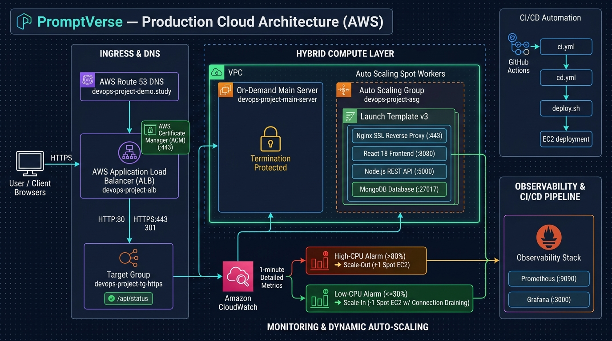

# ⚡ PromptVerse — Auto-Scaled, Highly Available Cloud Infrastructure on AWS

[](https://aws.amazon.com/elasticloadbalancing/)
[-232F3E?logo=amazon-aws&logoColor=white)](https://aws.amazon.com/ec2/autoscaling/)
[](https://www.terraform.io/)
[](https://aws.amazon.com/route53/)
[](https://aws.amazon.com/certificate-manager/)
[](https://aws.amazon.com/cloudwatch/)
[](https://prometheus.io/)
[](https://www.docker.com/)

An enterprise-grade, auto-scaled, and cost-optimized cloud architecture deployed on **Amazon Web Services (AWS)** using modern **DevOps & Infrastructure as Code (Terraform)** best practices for **PromptVerse**—a full-stack AI Prompt Engineering & Community Hub.

---

## 🌐 Live Application Endpoints

* 🔒 **Production HTTPS (Apex Domain)**: [https://devops-project-demo.study](https://devops-project-demo.study)
* 🔒 **Production HTTPS (WWW Subdomain)**: [https://www.devops-project-demo.study](https://www.devops-project-demo.study)
* 🎯 **Direct Health Check / Status Endpoint**: [https://devops-project-demo.study/api/status](https://devops-project-demo.study/api/status)
* 🔄 **Automatic HTTP-to-HTTPS Redirection**: Port 80 automatically redirects with `301 Moved Permanently` to secure Port 443.

---

## 🏛️ End-to-End System Architecture

```mermaid
graph TD
    Client["🌐 Public Traffic / Users"] -->|"HTTPS :443 / HTTP :80"| DNS["📡 AWS Route 53 DNS<br/>devops-project-demo.study & www"]
    
    DNS -->|"Alias A-Records"| ALB["⚖️ AWS Application Load Balancer<br/>devops-project-alb (Multi-AZ)"]
    
    subgraph Security ["🔐 Security & SSL/TLS Termination"]
        ACM["📜 AWS Certificate Manager<br/>Public SSL *.devops-project-demo.study"] -.->|"Attach TLS Cert"| ALB
        HTTP_Redirect["Port 80: HTTP ➔ 301 Redirect to HTTPS"] -.-> ALB
    end
    
    ALB -->|"HTTPS :443 Forward<br/>Health Check: /api/status"| TG["🎯 Target Group: devops-project-tg-https"]
    
    subgraph Compute ["☁️ Compute Layer (Hybrid Fleet)"]
        TG -->|"Registered Target"| MainServer["🖥️ On-Demand Main Server<br/>devops-project-main-server<br/>Protected • 24/7 Baseline"]
        TG -.->|"Dynamic Target Registration"| SpotServer["⚡ Spot Burst Workers<br/>Auto-Scaled • Desired: 0 at rest"]
    end

    subgraph AutoScaling ["📈 Dynamic Auto Scaling & Monitoring"]
        MainServer -->|"1-Min Detailed Metrics"| CloudWatch["📊 Amazon CloudWatch"]
        CloudWatch -->|"CPU > 80% Trigger"| AlarmHigh["🚨 High-CPU Alarm<br/>devops-project-alarm"]
        CloudWatch -->|"CPU <= 30% Trigger"| AlarmLow["📉 Low-CPU Alarm<br/>devops-project-low-cpu-alarm"]
        
        AlarmHigh -->|"Scale-Out Policy +1"| ASG["🔄 Auto Scaling Group<br/>devops-project-asg<br/>Min: 0, Desired: 0, Max: 2"]
        AlarmLow -->|"Scale-In Policy -1<br/>Connection Draining"| ASG
        
        LT["📋 Launch Template<br/>devops-project-lt v3<br/>Golden AMI ami-031e70f1ea741dc87"] -.->|"Spawns Spot Instances"| ASG
        ASG -.->|"Provisions"| SpotServer
    end

    subgraph Microservices ["🐳 Microservices Inside Docker (MERN Stack)"]
        MainServer & SpotServer --> DockerNet["mern-network"]
        DockerNet --> Nginx["Nginx SSL Reverse Proxy :443"]
        Nginx -->|"Static SPA Content"| ReactApp["⚛️ React 18 / Vite Frontend"]
        Nginx -->|"Proxy /api/*"| Backend["⚙️ Node.js Express REST API :5000"]
        Backend -->|"Data Persistence"| Mongo[("🍃 MongoDB Cache Engine")]
    end

    subgraph Observability ["📊 Observability & Metrics"]
        MainServer --> Prom["📈 Prometheus Server :9090"]
        Prom --> Graf["📊 Grafana Dashboard :3000"]
    end
```

<p align="center">
  
</p>



---

## 🚀 Key Architectural Highlights & Engineering Decisions

### 1. Hybrid Fleet Strategy & Cost Optimization
* **Permanent On-Demand Main Server (`devops-project-main-server`)**: Runs 24/7 with `disable_api_termination = true` to protect against accidental deletion. Handles baseline workloads continuously.
* **Zero-Cost At-Rest Auto Scaling Group (`devops-project-asg`)**: Manages **EC2 Spot instances** with baseline parameters (`Min = 0, Desired = 0, Max = 2`). When traffic is normal, secondary compute costs are **$0.00**.
* **Launch Template (`devops-project-lt`)**: Pre-configured with a hardened Golden AMI (`ami-031e70f1ea741dc87`) so new worker instances boot into ready-to-serve status in seconds without runtime build delays.

### 2. High-Velocity Reactive Dynamic Scaling
* **1-Minute Detailed CloudWatch Monitoring**: Replaced default 5-minute basic monitoring to enable sub-minute traffic reaction.
* **Scale-Out Policy (`scale-out-high-cpu`)**: Triggered by CloudWatch Alarm `devops-project-alarm` when Main Server CPU exceeds 80% for 1 minute. Adds +1 Spot instance to absorb the load.
* **Scale-In Policy (`scale-in-low-cpu`)**: Triggered by `devops-project-low-cpu-alarm` when CPU drops below 30%.
* **Connection Draining (Deregistration Delay)**: Configured with 300-second connection draining so ongoing client HTTP transactions complete cleanly without 502/504 errors before instance termination.

### 3. Traffic Management, Ingestion & Security
* **Application Load Balancer (ALB)**: Multi-AZ public load balancer (`devops-project-alb`) terminating client connections.
* **AWS Certificate Manager (ACM)**: Automated SSL/TLS certificate with DNS validation across root domain and wildcard subdomains (`*.devops-project-demo.study`).
* **Target Group (`devops-project-tg-https`)**: Protocol HTTPS on Port 443 with `/api/status` health check path to eliminate port 80 redirect loops.
* **Automatic HTTPS 301 Redirect**: Listener on Port 80 automatically redirects all unencrypted web requests to HTTPS 443.
* **Amazon Route 53**: Dualstack Alias A-records pointing apex and `www` subdomains directly to the ALB DNS name.

### 4. Stress Testing & Live Load Verification
* Simulated production traffic surges using `autocannon`:
  ```bash
  npx autocannon -c 250 -p 10 -d 180 https://devops-project-demo.study/api/status
  ```
* **Observed Metrics**:
  * Main Server CPU crossed **85.4%** under sustained load.
  * CloudWatch transitioned from `OK` to `ALARM` within 1 minute.
  * Auto Scaling Group executed `scale-out-high-cpu`, launched Spot instance `i-0badfd4fbaedfdf99`, and auto-registered it into `devops-project-tg-https`.
  * Target health transitioned to `healthy` and shared concurrent requests.
  * Upon load completion, `devops-project-low-cpu-alarm` triggered `scale-in-low-cpu`, connection draining completed, and capacity cleanly returned to 0.

### 5. Infrastructure as Code (IaC) with Terraform
* 100% of the AWS infrastructure is codified in clean, modular Terraform HCL files:
  * `terraform/main.tf` — Permanent On-Demand Main Server with termination protection.
  * `terraform/alb.tf` — ALB, HTTPS 443 listener, HTTP 80 redirect, and Target Group.
  * `terraform/asg.tf` — Auto Scaling Group, Spot scaling policies, and CloudWatch alarms.
  * `terraform/launch_template.tf` — Launch Template with Spot configuration and Golden AMI.
  * `terraform/acm.tf` — Public SSL certificate & Route 53 DNS validation records.
  * `terraform/route53.tf` — Route 53 Hosted Zone and ALB Alias A-records.
  * `terraform/network.tf` — Security Group firewall ingress/egress rules and default VPC lookup.
  * `terraform/variable.tf` & `terraform/outputs.tf` — Variables and infrastructure outputs.

### 6. Observability & Monitoring
* **Prometheus Server**: Running on port `9090` scraping system and container metrics.
* **Grafana Dashboard**: Running on port `3000` providing visual telemetry of resource utilization and container performance.

---

## 📁 Repository Directory Structure

```text
The-Prompt-Lab/
├── .github/
│   └── workflows/
│       ├── ci.yml               # Automated CI test & build verification
│       └── cd.yml               # Automated CD trigger to AWS EC2 via SSH
├── backend/
│   ├── config/                  # MongoDB connection & seed data
│   ├── controllers/             # REST API business logic
│   ├── models/                  # Mongoose data schemas (Prompt, User)
│   ├── routes/                  # Express route definitions
│   ├── Dockerfile               # Hardened Node.js Alpine container (USER node)
│   └── server.js                # API entrypoint & health checks
├── frontend/
│   ├── src/
│   │   ├── components/          # Responsive Navbar, Protected Routes
│   │   ├── pages/               # Home (with Pagination), User Guide, My Prompts
│   │   └── index.css            # Responsive styles & mobile animations
│   ├── Dockerfile               # Multi-stage Vite build + Unprivileged Nginx
│   └── nginx.conf               # SSL reverse proxy configuration
├── terraform/
│   ├── main.tf                  # Protected On-Demand Main Server
│   ├── alb.tf                   # Application Load Balancer & Listeners
│   ├── asg.tf                   # Auto Scaling Group & CloudWatch Alarms
│   ├── launch_template.tf       # Spot Instance Launch Template (Golden AMI)
│   ├── acm.tf                   # ACM SSL Certificate & DNS Validation
│   ├── route53.tf               # Route 53 Hosted Zone & ALB Alias Records
│   ├── network.tf               # VPC Security Group firewall rules
│   ├── variable.tf              # Input variable definitions
│   ├── outputs.tf               # Public IP, ALB DNS, and URL outputs
│   └── terraform.tfvars.example # Safe template for variables
├── scripts/
│   └── deploy.sh                # Production deployment script
├── docs/
│   ├── architecture.jpg         # Visual Architecture Diagram
│   ├── architecture.svg         # Vector Architecture Diagram
│   └── architecture.drawio      # Editable Draw.io Architecture Source
├── docker-compose.yaml          # Multi-container orchestration (MERN + Nginx)
├── .env.example                 # Environment configuration template
└── README.md                    # Project documentation
```

---

## 🛠️ Local Development & Quickstart

```bash
# 1. Clone the repository
git clone https://github.com/farazAhmed03/The-Prompt-Lab.git
cd The-Prompt-Lab

# 2. Configure environment variables
cp .env.example .env

# 3. Launch full stack via Docker Compose
docker compose up -d --build
```
* **Frontend**: `http://localhost:80`
* **Mongo-Express GUI**: `http://localhost:8081`
* **Backend Healthcheck**: `http://localhost:80/api/status`

---

## 🔒 Security Best Practices Implemented

1. **Zero Secret Leakage**: No private keys (`.pem`), AWS credentials, or sensitive `.env` files are tracked in version control.
2. **Instance Protection**: Main server has API termination protection enabled (`disable_api_termination = true`).
3. **Container Hardening**: Node.js backend runs under unprivileged `USER node`; Frontend Nginx runs under unprivileged UID `101`.
4. **Encrypted Communications**: End-to-end HTTPS/TLS 1.2+ encryption powered by AWS ACM.
5. **Private Subnet DB Isolation**: MongoDB engine communicates strictly over the internal container network (`mern-network`).

---

## 🗺️ Roadmap & Next Milestones

* [x] **Stage 1**: AWS EC2 Auto Scaling, ALB, ACM SSL, CloudWatch Dynamic Alarms, and Terraform IaC.
* [ ] **Stage 2**: Container Orchestration with **AWS EKS (Elastic Kubernetes Service)** — Helm charts, Kubernetes Deployments, Services, and Horizontal Pod Autoscalers (HPA).
* [ ] **Stage 3**: Serverless Containers with **AWS ECS (Elastic Container Service) on AWS Fargate**.
* [ ] **Stage 4**: Database Cloud Modernization — Migrating offline cache to **Amazon DynamoDB** (Serverless NoSQL).
* [ ] **Stage 5**: Bare-Metal Edge Cluster — Deploying **K3s / Rancher** on **NVIDIA Jetson** embedded GPU hardware.

---

## 👨‍💻 Author & Acknowledgements

* **Creator**: Faraz Ahmed ([@farazAhmed03](https://github.com/farazAhmed03))
* **License**: Open-Source under the [MIT License](LICENSE)
