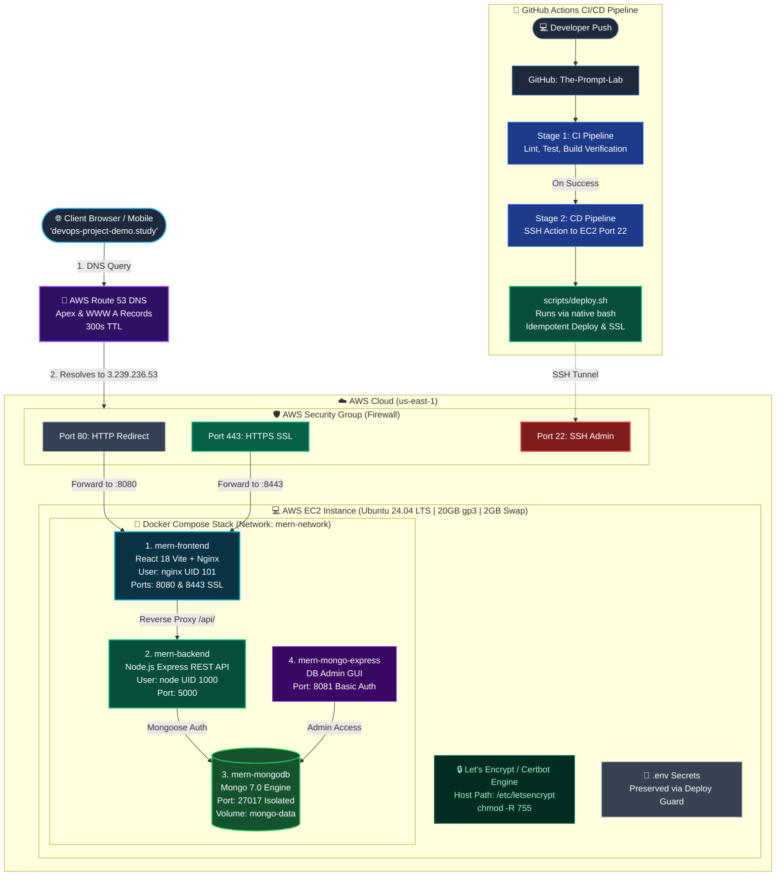

# 🎨 PromptVerse — Architecture Diagram & Draw.io Guide

Yeh guide aapko aapke project ka professional architecture diagram **Draw.io (diagrams.net)** mein open karne, edit karne, aur image download karne ka complete tareeqa batati hai.

---

## 🚀 Tareeqa 1: Direct File Open Karna (Sabse Aasan — 10 Seconds)

Aapke project ke andar already Draw.io ki official file create kar di gayi hai:
👉 **[`docs/architecture.drawio`](file:///c:/Users/faraz/Desktop/New%20folder/docs/architecture.drawio)**

### Steps:
1. Apne browser mein jayein: **[https://app.diagrams.net/](https://app.diagrams.net/)**
2. Top menu mein click karein: **File $\rightarrow$ Open From $\rightarrow$ Device** (ya apne computer se file chunein).
3. Apne computer se yeh file select karein:
   ```text
   C:\Users\faraz\Desktop\New folder\docs\architecture.drawio
   ```
4. **Boom!** 🎉 Poora professional dark-theme architecture diagram aapki screen par khul jayega jisme har box, icon, port, arrow aur colors perfectly set hain!

---

## ⚡ Tareeqa 2: Mermaid Code Copy-Paste Karna (2 Clicks)

Agar aap kisi naye blank canvas par instant generate karna chahte hain:

1. [app.diagrams.net](https://app.diagrams.net/) par jayein.
2. Top menu bar mein: **Arrange $\rightarrow$ Insert $\rightarrow$ Advanced $\rightarrow$ Mermaid** par click karein.
3. Niche diya gaya code copy karke wahan paste karein aur **Insert** daba dein:



---

## 🖼️ Image Export Karne Ka Tareeqa (PNG / PDF)

Jab aap Draw.io mein diagram open kar lein:
1. **File $\rightarrow$ Export as $\rightarrow$ PNG...** par click karein.
2. Options mein:
   * **Zoom**: `200%` ya `300%` select karein (Is se image ultra-HD crystal clear aayegi).
   * **Transparent Background**: Tick karein (agar dark slide par lagana ho) ya untick karein.
3. **Download** daba dein!
4. Yeh image aap apne **LinkedIn posts, resume links, project presentation, ya portfolio** mein laga sakte hain!

---

## 🏛️ Diagram ke Har Block ki Asaan Wazahath (Explain Kaise Karein)

| Box / Section | Rang (Color) | Iska Kaam Kya Hai? |
|---|---|---|
| **End Users / Client** | 🔵 Light Blue | Website open karne wale users (Chrome, Mobile, Desktop). |
| **AWS Route 53** | 🟣 Purple | DNS phonebook jo domain (`devops-project-demo.study`) ko IP `3.239.236.53` deti hai. |
| **AWS Security Group** | 🔴/🟢 Firewall | Server ka security guard: Port 80, 443, 22 ko filter karta hai. |
| **EC2 Host (Ubuntu 24.04)** | 🟡 Gold/Orange | Asli cloud computer jisme 20GB disk aur 2GB Swap RAM lagi hai. |
| **Let's Encrypt / Certbot** | 🟢 Emerald Green | Automatic SSL certificates issue karta hai taake site secure lock 🔒 ho. |
| **Docker Compose Stack** | 🟦 Docker Blue | 4 containers ka isolated network (`mern-frontend`, `mern-backend`, `mern-mongodb`, `mern-mongo-express`). |
| **CI/CD Pipeline (Left Side)** | 🔵 Dark Blue | Developer ka `git push` jo GitHub Actions aur `scripts/deploy.sh` ke zariye automatically deploy karta hai. |
